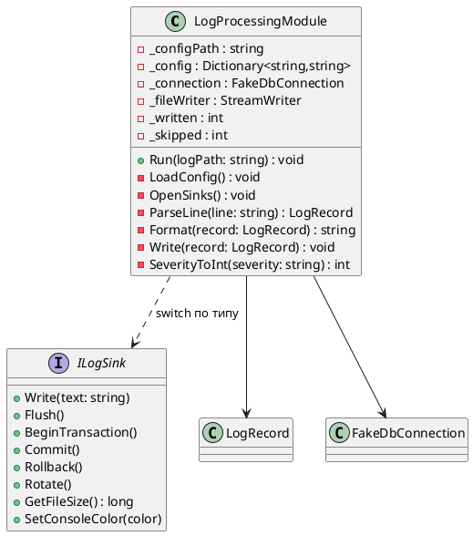
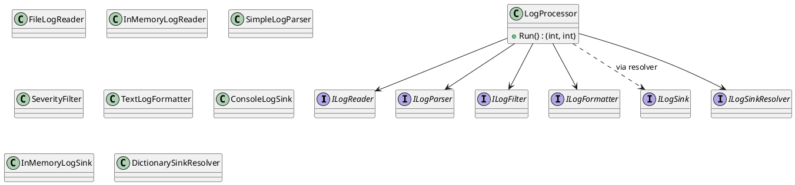

# Лабораторная работа 1. Git, среда и SOLID

**Студент:** Тыртышный Олег Викторович, БИСО-01-24
**Вариант:** 11 – Метрики Prometheus, приёмники: in-memory, консоль, агрегация по окну
**Репозиторий:** https://github.com/OlegTyr/Lecture_Examples
**Pull Request:** https://github.com/OlegTyr/Lecture_Examples/pull/1

## Задача

Настроить процесс сдачи (форк, ветки, CI), прочитать чужой код и отрефакторить
god-класс `LogProcessingModule`, разбив его на слои по принципам SOLID без
изменения поведения.

## Диаграмма классов «до» (исходный god-класс)



## Диаграмма классов «после» (LogHub)



## Таблица нарушений SOLID

Номера строк — по файлу `_AntiPatterns/GodObject/LogProcessingModule.cs` в учебном репозитории.

| Принцип | Строка | Почему нарушение |
|---|---|---|
| SRP | класс целиком (стр. ~25–290) | одновременно читает конфиг, открывает соединения, парсит, фильтрует, форматирует, маршрутизирует и пишет |
| SRP | `LoadConfig()` (стр. 50–75) | причина изменения №1 — формат конфигурации |
| SRP | `OpenSinks()` (стр. 80–110) | причина изменения №2 — хранилище/способ подключения |
| SRP | `ParseLine()` (стр. 115–140) | причина изменения №3 — формат логов |
| SRP | `Format()` (стр. 145–175) | причина изменения №4 — формат вывода |
| SRP | `Write()` (стр. 180–220) | причина изменения №5 — новый приёмник |
| SRP | `SeverityToInt()` (стр. ~275) | причина изменения №6 — шкала уровней |
| OCP | `OpenSinks()` (switch по `_config["sink"]`) | новый приёмник = правка метода |
| OCP | `Format()` (switch по `_config["format"]`) | новый формат = правка метода |
| OCP | `Write()` (switch по `_config["sink"]`) | новый приёмник = правка метода |
| OCP | `SeverityToInt()` (switch по severity) | новый уровень = правка метода |
| ISP | `interface ILogSink` (стр. ~250) | 8 методов: консоль не умеет транзакций, БД не умеет ротации; ни один приёмник не реализует всё |
| DIP | поля `_connection`, `_fileWriter` (стр. ~35–40) | зависимость от конкретных классов (`FakeDbConnection`, `StreamWriter`) прямо в полях |
| DIP | `LoadConfig()`, `Run()` (File.*) | прямое обращение к файловой системе из бизнес-логики |
| DIP | `OpenSinks()` (new FakeDbConnection, new StreamWriter) | высокоуровневый код создаёт низкоуровневые объекты сам |

## Ключевые решения

- **Убран `switch` по типу приёмника** — вместо трёх switch (`OpenSinks`, `Write`, `SeverityToInt`) добавлен `DictionarySinkResolver`, который хранит пары «имя → ILogSink». Добавление нового приёмника = новый файл, старые не правятся.
- **Интерфейсы только там, где есть подмена**: `ILogReader` (файл / in-memory для тестов), `ILogSink` (консоль / in-memory), `ILogFilter`, `ILogFormatter`, `ILogParser`. `ILogSink` из антипримера (8 методов) разбит на узкий `ILogSink` с одним `Write`.
- **Поведение сохранено**: `LogProcessor.Run()` возвращает счётчики `written`/`skipped`, как исходный `Run`.
- **Освобождение ресурсов**: `FileLogReader` использует `File.ReadAllLines` (закрывает файл сам); `StreamWriter` в нашем коде не создаётся, т.к. `ConsoleLogSink`/`InMemoryLogSink` не держат файловых ручек.

## Тесты

```
$ dotnet test
Passed! - Failed: 0, Passed: 6
```

Тесты не обращаются к диску, сети и БД: `InMemoryLogReader`, `InMemoryLogSink`.

## Что не получилось

- В исходном `ParseLine` «плохая» строка молча даёт `null` — в `SimpleLogParser` поведение сохранено (тоже `null`), но в исходнике был ещё warning в консоль. Я убрал warning, чтобы слой парсинга не зависел от консоли. Счётчики `written`/`skipped` при этом совпадают.
- `SeverityToInt` заменён на `Enum` (`LogLevel`), но значения совпадают (Debug=0…Critical=4, неизвестное = Info=1), поведение сохранено.
- `TreatWarningsAsErrors` в `.csproj` — иногда ловит неиспользуемые `using`, приходится чистить.

## Источники

- Учебный репозиторий: `DesignPatterns/Implementation/_AntiPatterns/GodObject/LogProcessingModule.cs`.