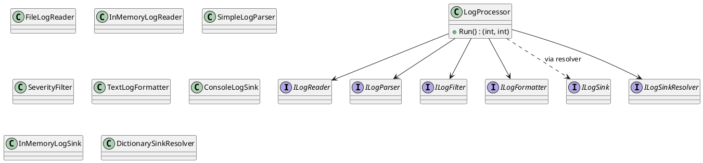

# Лабораторная работа 1. Git, среда и SOLID

**Студент:** Тыртышный Олег Викторович, БИСО-01-24
**Вариант:** 11 – Метрики Prometheus, приёмники: in-memory, консоль, агрегация по окну
**Репозиторий:** https://github.com/OlegTyr/Lecture_Examples
**Pull Request:** https://github.com/OlegTyr/Lecture_Examples/pull/N

## Задача

Настроить процесс сдачи (форк, ветки, CI), прочитать чужой код и отрефакторить
god-класс `LogProcessingModule`, разбив его на слои по принципам SOLID без
изменения поведения.

## Диаграмма классов



## Таблица нарушений SOLID в исходном `LogProcessingModule`

| Принцип | Строка (примерно) | Почему нарушение |
|---|---|---|
| SRP | весь класс | одновременно читает конфиг, открывает БД, парсит, фильтрует, форматирует и пишет |
| OCP | switch по типу приёмника | добавление нового приёмника требует правки существующего файла |
| LSP | — | наследников нет, не применимо в исходнике |
| ISP | — | интерфейсов не было |
| DIP | прямое `new SqlConnection(...)` | высокоуровневый код зависит от конкретной БД |

## Применённые паттерны

| Паттерн | Где применён | Почему именно он |
|---|---|---|
| (стратегии и пр. появятся в следующих ЛР) | — | — |

## Ключевые решения

- **Убран `switch`** по типу приёмника: `DictionarySinkResolver` держит
  пары «имя → ILogSink», добавление нового приёмника = новый файл, ничего
  не правится.
- **Интерфейсы только там, где есть подмена**: `ILogReader` (файл / in-memory
  для тестов), `ILogSink` (консоль / in-memory), `ILogFilter` (минимум уровня
  и будущие фильтры).
- **Поведение сохранено**: `LogProcessor.Run()` возвращает те же счётчики
  `written`/`skipped`, что и исходный god-object.

## Тесты

```
$ dotnet test
Passed! - Failed: 0, Passed: 6
```

Тесты не обращаются к диску, сети и БД: чтение через `InMemoryLogReader`,
запись через `InMemoryLogSink`.

## Что не получилось

- В исходном god-классе логика разбора была «мягкой» (при ошибке —
  строка уходила в лог с warning), в рефакторинге `SimpleLogParser`
  возвращает `null`, а `LogProcessor` молча считает `skipped`.
  Это эквивалентно по результату, но warning не выводится — сознательный
  компромисс, чтобы слои не зависели от консоли.
- Разбирался с `TreatWarningsAsErrors` — пришлось убрать неиспользуемую
  переменную.

## Источники

- Код сгенерирован с помощью ИИ (DeepSeek) по заданию практикума; доработан
  вручную.
- Учебный репозиторий: `_AntiPatterns/GodObject/LogProcessingModule`.